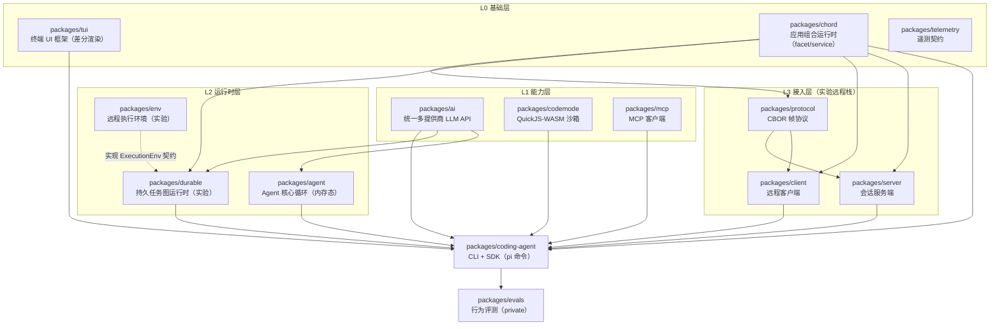
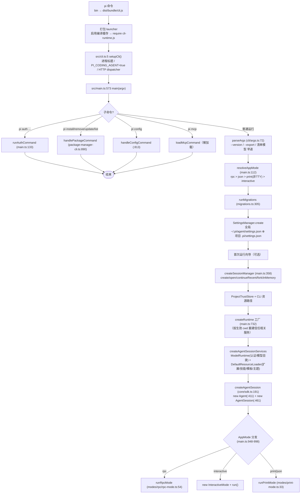
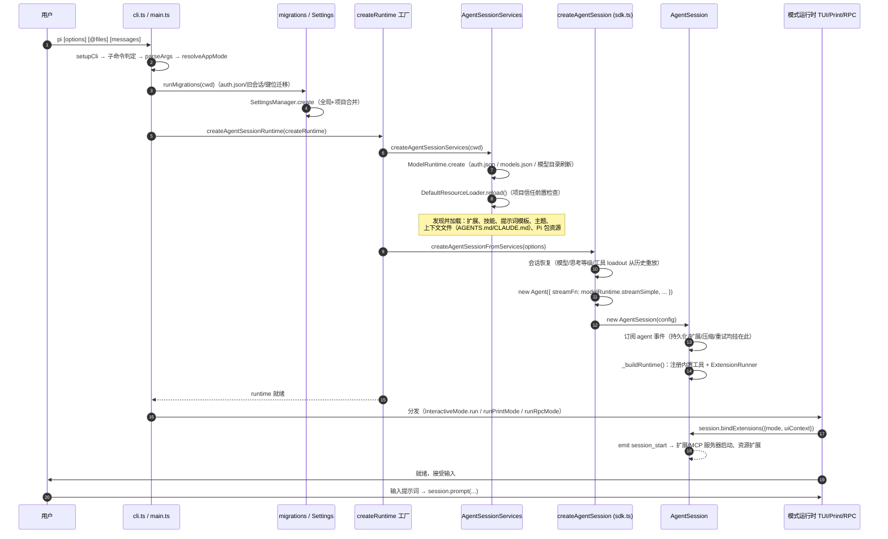
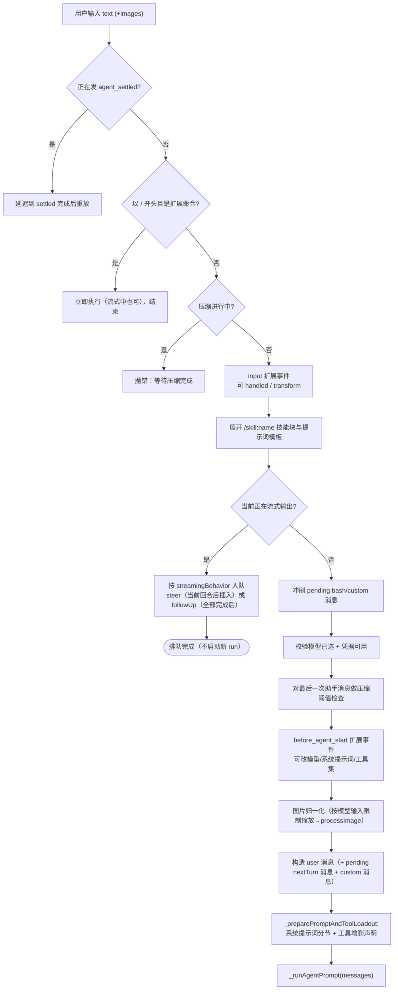
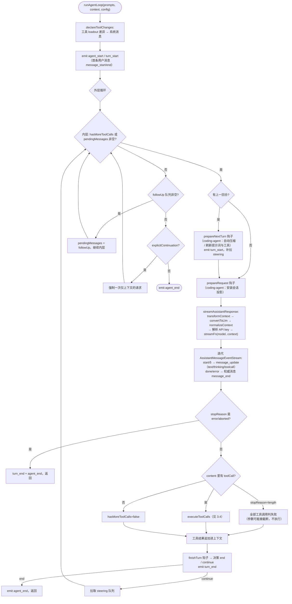
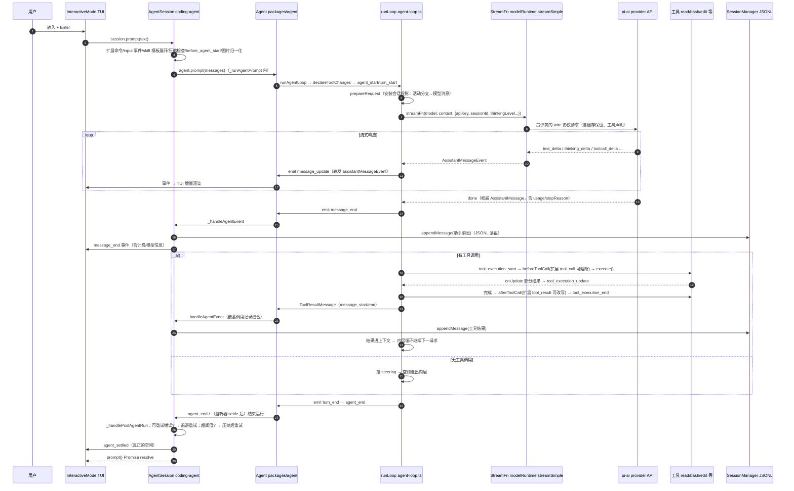
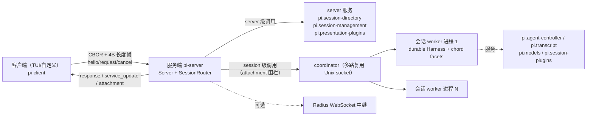

# pi 项目启动与执行流程详解

> 生成时间：2026-10-10 · 基于 `main` 分支（commit `42a3497d0`）
> 文中所有 `文件:行号` 均指向本仓库当前版本。Mermaid 图需要支持 Mermaid 的查看器（GitHub / VS Code / Obsidian / Typora）才能渲染。

---

## 0. 项目定位与总体结构

**pi** 是一个「极简、可扩展的终端编码代理（agent harness）」。它不做大而全的编排（没有内置子智能体、plan mode），而是把扩展点全部暴露出来：扩展（extensions）、技能（skills）、提示词模板、主题、Pi 包（通过 npm/git 分发）。

- npm 包：`@earendil-works/pi-coding-agent`，可执行命令 `pi`
- 运行要求：Node.js >= 22.19
- 组织形式：npm workspaces 单体仓库，14 个包
- 四种界面：交互 TUI（默认）/ print 单次执行 / JSON 事件流 / RPC 子进程控制；另有进程内 SDK

### 0.1 两条并存的技术路线（阅读本项目的第一原则）

仓库里实际存在**两套独立架构**，混在一起看会非常困惑，必须先区分：

| | 主线（stable，实际发布运行） | 实验线（experimental，`src/experimental/`） |
|---|---|---|
| Agent 循环 | `packages/agent`（内存态 `Agent` + `agent-loop.ts`） | `packages/durable`（持久化任务图 `Harness`） |
| 持久化 | `SessionManager` JSONL 会话文件（`core/session-manager.ts`） | `durable` 的 `Storage`（memory/jsonl/sqlite/Cloudflare DO） |
| 服务组合 | 无（单进程直接调用） | `chord` 服务框架（facet/service/replicated state） |
| 远程访问 | JSONL RPC 模式（stdin/stdout，稳定、有文档） | `protocol/client/server` CBOR 远程栈（`pi server`/`pi client`，`PI_EXPERIMENTAL` 门控） |
| 远程执行 | 无 | `packages/env`（SSH + Rust daemon） |
| 发布 | 包含 | 从构建/发布中排除（`tsconfig.build.json` 排除 `src/experimental`，`files` 排除 `dist/experimental`） |

> 注意：`packages/agent` **不依赖** `packages/durable`（v1.0.0 起把实验 harness 移出 agent-core，交给 pi-durable）。durable 是独立重写的持久化运行时，目前只被 coding-agent 的 experimental 代码使用。

**本手册以主线为重点**（第 2–4 章、第 6 章大部），实验线单独在第 4.2、5.2 节说明。

---

## 1. 模块地图

### 1.1 依赖分层图

构建顺序（根 `package.json` 的 `build` 脚本即依赖顺序）：
`chord → tui → telemetry → codemode → mcp → ai → durable → env → agent → protocol → client → server → coding-agent`



> `env` 实现了 durable 的 `ExecutionEnv` 契约但并无直接依赖边，图中以虚线示意设计对接关系。

### 1.2 各包一览

| 包 | 一句话职责 | 关键类/函数 | 被谁使用 |
|---|---|---|---|
| **coding-agent** | CLI 应用 + SDK：会话编排、工具实现、扩展系统、四种运行模式 | `main()`、`AgentSession`、`SessionManager`、`ExtensionRunner`、`InteractiveMode` | 终端用户、SDK 宿主 |
| **agent** | Agent 核心循环（provider 无关、内存态） | `Agent`、`runAgentLoop`、`runLoop` | coding-agent |
| **ai** | 统一 LLM API：42 个内置提供商 + faux 测试提供商、流式契约、认证、计费 | `createModels`、`Models.streamSimple`、`api/*` 各 wire 协议 | agent、coding-agent、（durable） |
| **tui** | 自研终端 UI 框架：差分渲染、CSI 2026 同步输出、Kitty 键盘协议、内联图片 | `TUI`、`TuiAltScreen`、`matchesKey`、`Editor` | coding-agent（89 个文件） |
| **chord** | 独立应用组合运行时：facet（可独立打包的插件片段）、类型化服务、复制状态、delta 事务 | `createFacetHost`、`defineService`、`replicatedState` | coding-agent/experimental、durable、server、client |
| **durable** | 持久会话/任务/文档运行时：提交后才可见，崩溃后从检查点恢复 | `Harness`、`Session`、`GenerationTask`、`ToolTask`、`Storage` | coding-agent/experimental（实验） |
| **env** | 远程执行环境：pi 本地、工具在远端（SSH + Rust daemon） | `RemoteExecutionEnv`、`connectSsh`、`deployDaemon` | 目前无仓库内消费者（durable `ExecutionEnv` 的替代实现） |
| **mcp** | 独立 MCP 客户端（不用官方 SDK）：stdio / Streamable HTTP / 内存传输 + OAuth 子集 | `McpClient`、`StdioTransport`、`StreamableHttpTransport` | coding-agent 的 MCP 内置扩展 |
| **codemode** | 模型写的 JS 在 QuickJS-WASM 沙箱中调用其他工具，嵌套调用不进上下文 | `CodemodeSandbox`、`renderDeclarations` | coding-agent 的 codemode 内置扩展 |
| **telemetry** | 厂商中立遥测契约：span/attribute/event + 一致性测试套件 | `TelemetryContext`、`InMemoryTelemetryContext` | 仅 `packages/ai` |
| **protocol** | 实验远程栈的线协议：CBOR + 4 字节长度前缀帧 | `PROTOCOL_VERSION=8`、`FrameDecoder`、`encodeClientMessage` | client、server |
| **server** | 传输无关的服务端：握手、请求分发、会话挂载（attachment fencing） | `Server`、`SessionRouter`、`ServerHost` | coding-agent/experimental（`pi server`） |
| **client** | 远程客户端：连接、服务调用、订阅、attachment 变更 | `Client`、`Connection`、`createClientServiceTransport` | coding-agent/experimental（`pi client`） |
| **evals** | coding-agent 的行为评测（vitest-evals；含 Docker 文档提升评测） | `createPiCodingAgentHarness`、`createTaskPlan` | 仅开发/CI |

---

## 2. 启动流程

### 2.1 入口链路总览（flowchart）



### 2.2 运行模式判定

| 模式 | 触发条件 | 分发位置 | 首个提示接受点 |
|---|---|---|---|
| `interactive`（TUI） | 默认；stdin+stdout 都是 TTY | `main.ts:951-983` | 编辑器提交回调 `interactive-mode.ts:3391` → 主循环 `getUserInput`（:4246） |
| `print`（单次） | `-p/--print`，或流被重定向且非 json/rpc | `main.ts:984-998` | `print-mode.ts:132` `session.prompt(initialMessage)` |
| `json` | `--mode json` | 同上 | 同上；事件经 `toJsonEvent` 写 stdout |
| `rpc` | `--mode rpc`（或 `rpc-entry` 入口） | `main.ts:948-950` | `rpc-mode.ts:394` `case "prompt"` |

判定函数 `resolveAppMode`（`main.ts:112-123`）：rpc > json > （stdin/stdout 非 TTY → print）> interactive。

### 2.3 启动初始化时序图



**启动期的几个要点：**

1. **两阶段设置加载**：`main.ts` 先加载设置（用于决定 sessionDir、是否需要信任弹窗），随后在 `createRuntime` 工厂里**按生效 cwd 重新加载**（`main.ts:750`），因此 `--session`/`--resume` 切进别的项目时会解析那个项目的配置与信任。
2. **项目信任（project trust）先于项目资源**：未受信任项目的 `.pi/` 配置、扩展、MCP 配置不会加载；`ProjectTrustStore` 在会话创建前构造（`main.ts:719`）。
3. **会话恢复先于工具装配**：SDK 从会话 JSONL 重放"系统消息"确定当时的提示词分节与工具清单（`_restoreToolsFromTranscript`，`agent-session.ts:1809`），再决定本轮激活哪些工具。
4. **`session_start` 是扩展的启动钩子**：`bindExtensions`（`agent-session.ts:3258`）中发出，MCP 内置扩展在此连接服务器（因此 SDK 使用方也必须调用 `bindExtensions`）。
5. **首次运行**可能有向导（选择模型/登录），非交互模式下若无可选模型会在 `main.ts:927` 直接报错退出。

### 2.4 打包形态

- `npm` 发布与安装脚本使用 `dist/bundle/`：esbuild 把 `dist/cli.js`→`cli-runtime.js`、`index`、`rpc-entry` 及各懒加载入口（OAuth、bedrock、worker）分别打包；`cli.js` 被替换为 4 行的 launcher（启用 `module.enableCompileCache`）。
- 另有 Bun 编译二进制形态：入口 `src/bun/cli.ts`（沙箱环境恢复、wasm/OAuth 初始化后转入 `../cli.ts`）。
- `rpc-entry` 是独立 bin 出口（自动注入 `--mode rpc`），供 `RpcClient` 拉子进程用。

---

## 3. 执行流程（核心）

### 3.1 `AgentSession.prompt()` 预处理流水线

用户的一条输入不是直接进模型的，`prompt()`（`core/agent-session.ts:1968-2111`）先过一条流水线：



### 3.2 核心 agent 循环（`packages/agent/src/agent-loop.ts`）

`runLoop`（`agent-loop.ts:163-321`）是双层 `while`：**内层**处理工具调用与 steering，**外层**在"本应停止"时再检查 follow-up 队列。



**几个关键设计：**

1. **提示词即转录（prompt-as-transcript）**：系统提示词分节和工具清单不存在 `context.systemPrompt` 里，而是以"系统消息"形式存在消息序列中；每次请求前 `declareToolChanges`（`agent-loop.ts:333`）把 `context.tools`（运行时可执行的）与转录里已声明的做差，把增删写成 `toolsAdded`/`toolsRemoved`。**重放消息序列即可还原任意时刻的提示词与工具状态**——这就是会话恢复能精确复原的系统机制。
2. **四个扩展钩子挂点**：`prepareRequest`（每请求前）、`prepareNextTurn`（每回合前，压缩挂这里）、`finishTurn`（回合结束决策 end/continue）、`beforeToolCall`/`afterToolCall`（工具级，见 3.4）。
3. **steering vs follow-up**：steering 在当前助手回合与其工具执行完**之后**、下一请求**之前**插入；follow-up 在"本来要停了"时把智能体重新拉起来。对应 UI 里的 `Enter`（引导当前任务）与 `Alt+Enter`（追加任务）。
4. **截断保护**：`stopReason === "length"` 时该消息里所有工具调用都不执行（参数可能被截断），全部合成失败结果（`agent-loop.ts:267-270`）。
5. **终止**：内层条件不满足（无工具调用、无 steering）且 follow-up 为空、无显式 continuation → 发 `agent_end`，运行结束。

### 3.3 一个完整回合的时序图



### 3.4 工具执行管道与审批

每个工具调用的完整管道（`agent-loop.ts`）：

| 阶段 | 动作 | 位置 |
|---|---|---|
| 1. 起始事件 | `tool_execution_start` | :484/:542/:597 |
| 2. 准备 `prepareToolCall` | 查工具 → `prepareArguments`（原始参数修正）→ `validateToolArguments`（TypeBox 校验）→ **`beforeToolCall` 钩子**：可 `{block:true, reason}` 阻断（产生错误结果，不执行） | :708-729 |
| 3. 执行 `executePreparedToolCall` | `tool.execute(id, args, signal, onUpdate)`；`onUpdate` 发 `tool_execution_update`；单调时钟计 `durationMs`；抛错转为 isError 结果 | :821-857 |
| 4. 收尾 `finalizeExecutedToolCall` | **`afterToolCall` 钩子**逐字段覆盖 content/details/usage/isError/terminate；内容被改而未给 structuredContent 时丢弃后者 | :859-895 |
| 5. 结束事件 | `tool_execution_end` | :919 |
| 6. 结果消息 | `ToolResultMessage`，emit `message_start`/`message_end` | :930-948 |

- **并行策略**：默认并行（`executeToolCallsParallel` :586）；任一被调用工具声明 `executionMode:"sequential"` 或全局配置要求时转顺序。并行时**预检顺序做、执行并发做、结果消息按助手消息中的源顺序发出**。
- **审批（permission）语义**：agent-core **只提供钩子**，没有内置权限系统（README 明确说明）。策略全部由消费方定义：coding-agent 把 `beforeToolCall`/`afterToolCall` 路由到扩展的 `tool_call`/`tool_result` 事件（`agent-session.ts:652-724`），扩展（如 MCP 扩展、沙箱扩展）在此阻断或改写。
- **批量终止**：仅当该批**所有**结果的 `terminate === true` 才终止循环（`:690`）。
- **嵌套工具调用**：工具可通过 `ctx.executeTool(name, args)` 调其他工具（codemode 的核心）。走同一条 prepare/validate/hooks 管道（`runToolCall` :811），**不发事件、不写消息**，由会话层 `NestedToolCallRunner`（`core/nested-tool-calls.ts:161`）统一编号 `<callerId>/<n>`、发带 `parentToolCallId` 的 `tool_execution_*` 事件、把有界摘要记到发起者工具结果消息的 `nestedCalls` 字段。
- **结构化输出**：`content` 面向模型，`structuredContent` 面向机器（codemode 脚本取用），绝不进模型上下文。

### 3.5 事件体系

`AgentEvent`（`packages/agent/src/types.ts:516`）→ `AgentSessionEvent`（`agent-session.ts:196`，加了会话级事件）→ 对外经 `session.subscribe()` / JSON / RPC 输出。

| 事件 | 含义 |
|---|---|
| `agent_start` / `agent_end` | 低层 run 开始/结束（`agent_end` 后仍可能有重试/压缩/排队工作） |
| `agent_settled` | pi 不会再自动继续（真正的空闲）；`aborted` 标识是否被中止 |
| `turn_start` / `turn_end` | 一个助手响应 + 其工具调用与结果的回合边界 |
| `message_start` / `message_update` / `message_end` | 消息生命周期；`message_update.assistantMessageEvent` 携带 `text_delta`/`thinking_delta`/`toolcall_delta` 等增量；`message_end` 是权威完成消息 |
| `tool_execution_start/update/end` | 工具生命周期（嵌套调用带 `parentToolCallId`） |
| `queue_update` | steering/follow-up 队列变化（给 UI 显示排队消息） |
| `compaction_start/end`、`auto_retry_start/end`、`summarization_retry_*` | 压缩与重试 |
| `entry_appended`、`session_info_changed`、`thinking_level_changed` | 会话元数据变化 |

### 3.6 续跑、重试与压缩

- **回合后处理**（`_handlePostAgentRun`，`agent-session.ts:1853`）：助手消息可重试错误（过载/限流/5xx）→ 指数退避自动重试（`_prepareRetry` :3762）；超上下文阈值或 provider 溢出错误 → 压缩一次后重试（`_checkCompaction` :2947 / `_runAutoCompaction` :3097）。
- **自动压缩触发**：`contextTokens > contextWindow − reserveTokens`（默认 reserve 16384 / 保留最近 20000 tokens，可在 settings 按模型覆盖）。触发点：每次提示词提交前、工具批结果追加后的回合准备阶段、以及溢出恢复。
- **压缩机制**：从活动分支投影回退累计 token 找到切点（工具结果不可作切点）→ LLM 生成结构化摘要（Goal/Progress/Key Decisions/Next Steps/…含读写文件清单）→ 追加 `CompactionEntry` 记录 `firstKeptEntryId` → 之后重建上下文时用"摘要 + firstKeptEntryId 起保留段"替代更早消息；原始条目保留在会话树中（可回看）。溢出恢复还会先给被放弃的那次尝试追加 `context_edit` 省略编辑，再压缩、重试。
- **抢占与中止**：`abort()`/Escape → AbortController 贯穿流与工具；queued 消息退回编辑器；重试/压缩均可单独中止（`abortRetry`/`abortCompaction`）。
- **`/tree` 分支导航**：切换分支时可用 LLM 生成"离开分支的摘要"（`BranchSummaryEntry`）注入新分支，`navigateTree`（`agent-session.ts:3964`）。

---

## 4. 持久化与上下文重建

### 4.1 主线：JSONL 会话树（coding-agent）

- **位置**：`~/.pi/agent/sessions/--<路径转义>--/<时间戳>_<会话ID>.jsonl`；`--no-session` 用内存管理器。
- **结构**：每行一个 JSON 条目，`id`/`parentId` 构成**树**（v3），活动分支 = 当前叶子到根的路径；继续/分叉/克隆都在同一文件内生长，不新开文件。
- **条目类型**（`core/session-manager.ts`）：`session`（头）｜`message`（AgentMessage）｜`model_change`｜`thinking_level_change`｜`usage`（不参与 LLM 上下文，仅计费，如 cache_warm）｜`compaction`（摘要 + `firstKeptEntryId` + 提示词/工具检查点）｜`context_edit`（追加式改写历史条目对未来上下文的影响）｜`branch_summary`｜`custom`（扩展状态，不进上下文）｜`custom_message`（扩展注入，进上下文）｜`label`｜`session_info`。
- **系统消息即检查点**：首条 `message`（role=system）持久化全部分节与工具声明；之后的变化以 system 消息的 `sections` 补丁（null 删除）与 `toolsAdded/toolsRemoved` 表达。**按序重放即得当前提示词与工具集，无需单独状态条目**。
- **上下文重建三步**（`session-manager.ts`：`buildContextEntries` → `buildSessionProjection` → `buildSessionContext`）：
  1. 从叶子向根收集路径上的条目，按最新 `compaction` 应用"摘要 + 保留段"裁剪；
  2. 应用每个目标的最新 `context_edit`（省略/替换内容，不动原始条目）；
  3. 转为模型消息：`message`→原消息；`compaction`→系统检查点+`compactionSummary`；`branch_summary`→`branchSummary`；`custom_message`→`custom`；`usage`/`custom`→不产生上下文消息。
- **版本**：v1 线性（加载时自动迁移）→ v2 树 → v3 角色改名（hookMessage→custom），加载即迁移（`migrations.ts` 另处理更早的 auth.json 等）。

### 4.2 实验线：durable 持久运行时（`packages/durable`，README 标注 experimental）

与主线并行的另一套设计：**一切先提交到存储，再对外可见**；进程中途死掉，重开存储即可从最后检查点继续。

- **内核**：`Session`（对 `Storage` 的唯一变更线：`commit`/`close`/`subscribeCommits`，`src/session/session.ts:68`）+ 事务 `Tx`（追加条目、建任务、改文档——基于 chord delta 跟踪）。
- **Harness**（`src/harness/harness.ts:437` `Harness.open`）在 Session 上跑**任务图**：
  - `pi.generation`——模型请求/流式/检查点一体化状态机（阶段 prepare→request→tool/poll→…，`harness/generation.ts`），流式增量节流（~100ms）写 `pi.live` 文档，完成后 `appendEntry(AssistantEntry)`；
  - `pi.tool`——每个工具调用一个任务（`harness/tool.ts`），等待策略 `allSettled`，结果写 `pi.tool-result` 条目；支持嵌套（`kind:"nested"`、按调用者分文档 `NestedResultDoc`）与 `callers`（"model"/"tools"）声明；
  - `pi.compaction`——压缩任务同样检查点化。
- **存储后端**：`MemoryStorage`、`JsonlStorage`、`SqliteStorage`（node）、Cloudflare Durable Object SQLite。
- **存储错误终结会话**（三条规则）：
  1. **存储错误终止整个 Harness/Session**——出错调用原样 reject；之后每个调用与等待都以 `SessionFailed` 拒绝（cause=首个错误）；watch 以 `session_failed` 结束；运行中任务收到 abort；不自动重试；重开存储从已提交状态恢复；相同 `requestId` 重提交会找回已受理的提交。
  2. 对存储的**坏请求只失败该次调用**（`StorageRequestError`）。
  3. **用户代码只影响自己的单元**（任务阶段抛错只坏该任务；工具抛错只产生错误结果）。
  实现：`GuardedStorage` 包裹所有后端调用（`src/session/session.ts:712`），首个非豁免错误经 `SessionImpl.fail()` 闩锁。
- **使用现状**：coding-agent 的 `src/experimental/`（`harness-setup.ts`、`services/*`、`vacation/*`）——每区域一个 `session.sqlite`；构建与发布均排除。

### 4.3 实验线：env 远程执行（`packages/env`）

把 durable 的 `ExecutionEnv` 实现为"本地 worker + SSH 远端 Rust daemon"：帧协议（u32 长度 + u8 类型 + JSON/raw，单帧上限 16MiB，`PI-ENV <token>` 同步行），严格 host-key 校验、批量模式、不开转发。当前仓库内尚无消费者（durable 自己带 `NodeExecutionEnv`）。

---

## 5. 远程与集成接口

### 5.1 RPC 模式（稳定接口，`pi --mode rpc`）

- 长生命周期子进程：stdin 收 JSONL 命令，stdout 出 JSONL 响应 + 会话事件。**严格 JSONL 分帧**（只按 `\n` 分割；不要用会把 U+2028/29 当分隔的 `readline`；stdout 只放协议、日志走 stderr）。
- 四类记录：stdin `Command`（`prompt`/`steer`/`abort`/`get_state`/`set_model`/`compact`/`bash`/…，`rpc-types.ts:20-74`）；stdout `response`（`{id, type:"response", command, success, data|error}`）；stdout 会话事件（同 JSON 模式的形状）；双向扩展 UI 记录。
- 命令可带 `id`，响应原样回带；异步处理，**按 id 关联而非顺序**。
- `prompt` 响应只表示受理（`data.disposition`：`started`/`queued`/`handled`）；判断"跑完"要等 **`agent_settled`**（`agent_end` 之后还可能重试/压缩/排队）。
- 关闭：关 stdin 有序退出；当前命令或当前 run settled 后进程退出。
- 类型化客户端：`RpcClient`（`modes/rpc/rpc-client.ts:56`，spawn `node cli.js --mode rpc`）。

### 5.2 实验性 client/server 远程栈（`PI_EXPERIMENTAL` 门控）



- **线协议**（`packages/protocol`）：`PROTOCOL_VERSION = 8`；4 字节大端长度前缀帧（默认上限 16MiB）；TypeBox 校验后 CBOR 编解码；`hello` 恒等版本协商。`call` 载荷对协议层**不透明**（JSON），服务契约演进不需要升版本。
- **调用语义**（`chord`）：`call = {serviceId, instance?, member, args[]}`；`$chord.service` 保留控制成员 `catalogue`/`subscribe`/`unsubscribe`；订阅先原子快照、后增量更新（`state/reset/unavailable/replaced/spawned/closed`）。
- **服务端**：`Server`（握手 5s 超时、`serverId` 围栏）→ session 级目标路由 `SessionRouter`（挂载即发 `attachment{attachmentId}`，后续调用必须携带当前 attachment，防串会话）；`ServerHost` 是应用接缝（`resolveSession`/`openSession`）。
- **客户端**：`Client.connect` 发 hello、校验 `serverId`/版本；`request`/`serviceCatalogue`/`subscribeService`（快照水合前缓冲更新）；Unix 传输探测 `~/.pi/server/<serverId>.sock`。
- **coding-agent 侧**：`pi server`（`experimental/server.ts:493`）按目录维护 serverId（锁文件）、coordinator 多路复用、每会话一个 node worker 进程（持 durable Harness，锁会话目录）、可选 Radius 中继。`pi client` 激活 `SessionDirectory/SessionManagement/Models/AgentController/Transcript` 等门面。
- 交互链路：`AgentController.prompt → 调用经 coordinator → worker 操作 → conversation.submit`；转录以复制状态增量回推渲染。

### 5.3 SDK（进程内嵌入）

```typescript
import { createAgentSession } from "@earendil-works/pi-coding-agent";
const { session } = await createAgentSession();   // 用 cwd/发现资源/设置/凭证
try {
  const unsub = session.subscribe(e => { /* message_update / tool_execution_* ... */ });
  await session.prompt("解释这个仓库");              // run 结束才 resolve
  console.log(session.getLastAssistantText());
} finally { session.dispose(); }
```

- `createAgentSession()` 默认装配：`ModelRuntime` + 文件 `SettingsManager` + 持久 `SessionManager` + `DefaultResourceLoader`（扩展/技能/模板/主题/上下文文件）+ 默认工具集；各边界都可用参数替换（自定义工具、内存会话、自定义资源加载器）。
- 替换会话用 `AgentSessionRuntime`（`newSession`/`switchSession`/`fork`/`importFromJsonl`，替换后需重新绑定订阅）。
- SDK 会话**不带** CLI 的内置扩展；要用 codemode/tool_search/MCP 需把 `createCodemodeExtension()`/`createToolSearchExtension()`/`createMcpExtension()` 加进 `DefaultResourceLoader`，并调用 `session.bindExtensions()`（MCP 在 `session_start` 时连接）。
- 注意 `prompt()` 的流式约束：正在跑时必须明确 `steer` 或 `followUp`（`session.steer()`/`session.followUp()` 返回 `"queued"`/`"handled"`）。

---

## 6. 模块-文件功能矩阵

### 6.1 coding-agent（`packages/coding-agent/src/`）

| 目录 | 作用 | 关键文件 → 功能 |
|---|---|---|
| `cli.ts` / `main.ts` / `config.ts` | 进程入口与总编排 | `cli.ts`(setupCli→main)；`main.ts`(子命令/模式判定:112/会话选择:358/运行时工厂:732/分发:948)；`config.ts`(agent 目录/资产路径解析，禁止直接用 `__dirname`) |
| `cli/` | 参数与启动界面 | `args.ts`(parseArgs:72)；`setup.ts`(进程预配置)；`startup-ui.ts`(首次运行向导)；`session-picker.ts`/`config-selector.ts`/`list-models.ts`(选择器)；`initial-message.ts`+`file-processor.ts`(`@file`/stdin 初始消息)；`project-trust.ts` |
| `core/` | **会话编排核心** | `agent-session.ts`(AgentSession 4399 行：prompt/压缩/重试/队列/工具注册/扩展绑定)；`agent-session-runtime.ts`(会话替换)；`agent-session-services.ts`(按 cwd 建服务)；`sdk.ts`(createAgentSession)；`session-manager.ts`(JSONL 树)；`settings-manager.ts`；`resource-loader.ts`(扩展/技能/模板/主题发现)；`model-runtime.ts`+`model-resolver.ts`+`model-registry.ts`+`models-store.ts`(模型选择/目录/认证)；`auth-storage.ts`；`trust-manager.ts`；`tools/`(见下)；`compaction/`；`extensions/`(见下)；`messages.ts`(convertToLlm)；`nested-tool-calls.ts`；`cache-warmer.ts`；`bash-executor.ts`；`system-prompt.ts`；`migrations.ts`(在 src 根) |
| `core/tools/` | 内置工具实现 | `read.ts`/`bash.ts`/`edit.ts`(+`edit-diff.ts`)/`write.ts`/`grep.ts`/`find.ts`/`ls.ts`/`powershell.ts`；`index.ts`(createAllToolDefinitions:182)；`file-mutation-queue.ts`(写串行化)；`truncate.ts`(输出截断)；`renderers/`(TUI 渲染) |
| `core/compaction/` | 压缩与分支摘要 | `compaction.ts`(findCutPoint/prepareCompaction/compact)；`branch-summarization.ts`；`utils.ts`(serializeConversation，工具结果截 2000 字符) |
| `core/extensions/` | 扩展系统 | `loader.ts`+`jiti-loader.ts`(TS 直接加载)；`runner.ts`(ExtensionRunner 事件分发)；`types.ts`(全部扩展事件类型)；`virtual-modules.ts`(向扩展暴露 pi 虚拟模块) |
| `modes/` | 运行界面实现 | `interactive/`(interactive-mode.ts 主界面、chat-viewport、components/ 组件、theme/)；`print-mode.ts`；`json-event.ts`(事件→JSONL 变换)；`rpc/`(rpc-mode.ts 服务端循环、rpc-client.ts、rpc-types.ts、jsonl.ts) |
| `extensions/` | CLI 内置扩展 | `codemode/`(沙箱执行+渲染)；`tool-search/`；`mcp/`(config/连接/工具包装/OAuth/UI)；`llama/`(llama.cpp) |
| `experimental/` | 实验线装配（已从构建排除） | `commands.ts`(`pi server`/`pi client`)；`server.ts`+`coordinator.ts`+`session-worker*.ts`；`client-runtime.ts`；`services/`(chord 服务定义)；`durable/`(Harness 接线)；`vacation/` |
| `client/`·`bun/`·`utils/` | 杂项 | `client/`(实验客户端入口)；`bun/cli.ts`(二进制入口)；`utils/`(shell/剪贴板/图片/前端元数据) |

### 6.2 agent（`packages/agent/src/`）

| 文件 | 功能 |
|---|---|
| `agent.ts` | `Agent`(:188)：状态、队列(143)、订阅(:266)、事件归约 processEvents(:565)、运行生命周期 runWithLifecycle(:507)、失败合成 handleRunFailure(:532) |
| `agent-loop.ts` | 核心循环：`runAgentLoop`(:102)/`runAgentLoopContinue`(:128)/`runLoop`(:163)、工具管道(:708/:821/:859)、截断保护(:478)、嵌套入口 runToolCall(:811) |
| `types.ts` | `StreamFn`(:33)、`AgentTool`(:466)、`AgentEvent`(:516)、钩子类型 |
| `stream-fn.ts` | `setDefaultStreamFn`：宿主注入 LLM 流的默认实现 |
| `proxy.ts` | `streamProxy`：把服务端 SSE 代理为 StreamFn 用 |

### 6.3 ai（`packages/ai/src/`）

| 文件 | 功能 |
|---|---|
| `types.ts` | 全部核心类型：消息/Tool/Context/Model、`StreamOptions`(缓存保留/sessionId)、`ProviderStreams` |
| `models.ts` | 运行时注册表：`createModels`(:992)、`Models.streamSimple`(:901)、`calculateCost`、思考等级夹取 |
| `models.generated.ts` | 生成的模型目录（由 `scripts/generate-models.ts` 生成，**禁止手改**） |
| `providers/*` | 每提供商一个工厂（`anthropicProvider` 等）；`all.ts` 汇总 42 个内置提供商 |
| `api/*` | wire 协议实现：anthropic-messages、openai-completions/responses(/codex/azure)、google-generative-ai/vertex、bedrock、mistral、pi-messages、图片/分类模型 |
| `compat.ts` | 旧版全局 API（无目录的 stream/complete） |
| `auth/*`、`oauth.ts`、`env-api-keys.ts`、`models-store.ts`、`utils/*` | 认证/OAuth/环境键名/持久模型目录/事件流/校验/溢出检测/重试 |

### 6.4 其余包（简表）

| 包 | 关键文件 → 功能 |
|---|---|
| tui | `tui.ts`(Component:117/TUI:464/Container/overlay)、`tui-main-screen.ts`/`tui-alt-screen.ts`(两种屏幕模式)、`keys.ts`(matchesKey:859/键位管理)、`terminal.ts`(ProcessTerminal 自研 ANSI 层)、`native/`(可选 N-API 预编译：剪贴板/修饰键) |
| chord | `api.ts`(createFacetHost:22/defineFacet:69/defineService:73/replicatedState:91)、`facets/host.ts`(FacetKernel:340 依赖图校验/逆序释放)、`services/*`(远程服务 provider/binding/状态副本)、`delta/*`(JSON delta 跟踪与修订校验)、`node/`(facet 打包) |
| durable | `session/session.ts`(createSession:68/GuardedStorage:712)、`session/transaction.ts`(Tx)、`harness/harness.ts`(Harness:437)、`harness/generation.ts`/`tool.ts`/`compaction.ts`/`scheduler.ts`、`storage/`(memory/jsonl/sqlite/cloudflare)、`env/`(ExecutionEnv)、`documents.ts`(defineDoc)、`entries.ts`(pi.user/assistant/tool-result/compaction...) |
| env | `ssh.ts`(sshArguments:77/scanHostKey:182/deployDaemon:396)、`connection.ts`(帧连接:168)、`remote-env.ts`(RemoteExecutionEnv:351)、`daemon/src/*.rs`(Rust 守护进程：main/frame/exec/fs/scan/watch) |
| mcp | `client.ts`(McpClient:153)、`transports/`(stdio:69/streamable-http:188/in-memory)、`protocol/jsonrpc.ts`+`content.ts`(toLlmContent)、`oauth/`(flow:314/adaptOAuthProvider:451) |
| codemode | `runtime/host.ts`(CodemodeSandbox:340，Worker+超时/内存限制)、`wasm.ts`(loadQuickJSWasm)、`declarations.ts`(schema→TS 声明)、`source.ts`(`// @options:` 语法) |
| telemetry | `index.ts`(TelemetryContext:11/TelemetrySpan:15)、`noop.ts`、`memory.ts`、`testing/conformance.ts` |
| protocol | `protocol.ts`(消息模式/VERSION=8)、`framing.ts`(FrameDecoder)、`codec.ts`(TypeBox+CBOR) |
| server | `server.ts`(Server:46/握手/分发:306)、`session-router.ts`(SessionRouter:34/attachment 围栏)、`listener.ts`+`transports/unix/`(0o600 socket) |
| client | `client.ts`(Client:62/subscribeService:172/chord 适配:448)、`connection.ts`(hello/帧泵)、`unix.ts`(发现 `~/.pi/server/*.sock`) |
| evals | `harness.ts`(createPiCodingAgentHarness:471)、`plan.ts`(createTaskPlan:39)、`docker.ts`(双变体镜像)、`report.ts`(lift 计算)、`evals/*.eval.ts` 套件 |

---

## 7. 扩展机制速览（pi 可定制性的落点）

- **扩展（Extensions）**：TypeScript 模块，加载进 pi 进程，工厂函数注册工具、命令、快捷键、提供商、事件处理器、渲染器、终端 UI。可用 `jiti` 直接加载 TS（`core/extensions/jiti-loader.ts`）。事件点覆盖整个生命周期：`session_start`/`input`/`tool_call`/`tool_result`/`before_agent_start`/`turn_end`/`agent_before_settle`/`session_before_compact`/`session_before_tree`/`provider_request` 等（类型见 `core/extensions/types.ts`）。
- **技能（Skills）**：按需加载的指令包；`/skill:name` 展开为技能块（`_expandSkillCommand`）。
- **提示词模板**：编辑器输入先展开模板再成为用户消息。
- **主题 / keybindings**：`DEFAULT_EDITOR_KEYBINDINGS`/`DEFAULT_APP_KEYBINDINGS` 集中定义、可覆盖（规范禁止硬编码按键判断）。
- **Pi 包**：把上述资源打包经 npm/git 分发（`pi install <source>`、`pi config`）。
- **内置扩展**：`codemode`（QuickJS 沙箱里写 JS 批量/并行调工具，只有脚本输出进上下文）、`tool_search`（按需发现未声明工具）、`mcp`（连接 MCP 服务器，暴露方式 direct/codemode/deferred 可配）。CLI 默认加载它们（可 `-ne` 关闭）；SDK 需手工添加。
- **项目信任**：未信任项目的 `.pi/` 项目级设置、扩展、MCP 配置不加载（`pi -na` 忽略 / `-a` 单次信任）。

---

## 8. 源码阅读路线（建议顺序）

1. `packages/coding-agent/src/main.ts` —— 一切启动的编排
2. `packages/coding-agent/src/core/sdk.ts` → `core/agent-session.ts` —— 会话如何装配（Agent + SessionManager + 工具 + 扩展）
3. `packages/agent/src/agent-loop.ts` —— 核心循环本体（读 runLoop 一个函数即可抓住主干）
4. `packages/agent/src/agent.ts` —— 状态与事件归约
5. `packages/ai/src/models.ts` + `types.ts` + 任一 `api/*.ts` —— LLM 调用如何发出
6. `packages/coding-agent/src/core/session-manager.ts` —— JSONL 会话树与上下文重建
7. `packages/coding-agent/src/core/extensions/runner.ts` + `types.ts` —— 扩展事件体系
8. `packages/coding-agent/src/modes/interactive/interactive-mode.ts` —— TUI 主循环（大，按 run()/init() 分段读）
9. 实验线（按需）：`packages/durable/docs/spec.md` → `src/harness/*` → `packages/protocol`/`server`/`client`
