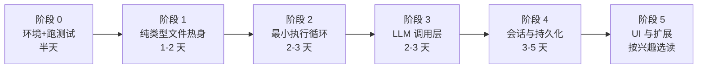

# pi 源码学习指南 —— 写给 TS 基础薄弱的开发者

> 目标读者：会编程（最好有点 JS 基础）、TypeScript 只懂个大概、想把这套源码读懂的开发者。
>
> 本文回答两个问题：
>
> 1. **应该按什么顺序学**（第 3 章的五个阶段）；
> 2. **需要先补哪些 TS 知识**（第 2 章，只讲这个项目真正用到的，每条都配真实代码出处）。
>
> 配套：《PI_ARCHITECTURE_ZH.md》是"这个项目是怎么跑的"地图；本文是"带你读懂源码"的教练。两者按第 6.4 节索引交叉使用。

---

## 0. 先吃三颗定心丸（5 分钟）

**① 这个项目的 TS 是"最好学"的那一类。**
`tsconfig.base.json:7` 开启了 `erasableSyntaxOnly`：全仓库**没有 enum、没有 namespace、没有参数属性、没有装饰器**（我统计过：`packages/*/src` 中 enum 声明数为 0）。类型注解在运行时会被 Node **直接擦掉**。也就是说：这里 80% 的代码就是普通 JavaScript 加上"给数据贴的标签"。你不需要学 TS 的全套内幕就能开始读。

**② 源码不需要编译，可以直接跑。**
Node ≥ 22.19 原生支持擦除类型运行 `.ts`。`./pi-test.sh` 就是用这种方式直接跑源码的（见 1.3）。

**③ 学习顺序 ≠ 构建顺序。**
不要从 `packages/coding-agent`（最大、最杂）开始。正确顺序是**自底向上三个包**：
`packages/agent`（循环本体，约 3000 行）→ `packages/ai`（LLM 调用，挑着看）→ `packages/coding-agent`（会话编排与 CLI，最后看）。

---

## 1. 环境准备（约 30 分钟）

### 1.1 安装

```bash
# 环境：Node >= 22.19、npm
node --version

cd <仓库根目录>
npm install --ignore-scripts   # 项目规定：不跑依赖的 lifecycle 脚本（供应链安全）
```

> 为什么必须 `--ignore-scripts`：见 `AGENTS.md` 的 "Dependency and Install Security" 一节——这个项目把依赖变更当代码审查，禁止依赖包在安装时执行脚本。

### 1.2 跑测试（读源码前先会跑）

```bash
# 从仓库根目录：跑全部非 e2e 测试（没有 API key 也能跑）
./test.sh

# 跑单个测试文件（以 agent 包为例，从包根目录执行）
cd packages/agent
node "$(git rev-parse --show-toplevel)/node_modules/vitest/dist/cli.js" --run test/agent-loop.test.ts
```

> 测试是这个项目**最重要的活文档**：测试名就是行为规格。学习阶段"读测试 + 跑测试"的性价比远高于通读实现。

### 1.3 从源码直接运行 pi

```bash
./pi-test.sh          # 等于 node --import <source-resolver.ts> packages/coding-agent/src/experimental/cli.ts
./pi-test.sh --help
```

这里藏着第一个学习点（`packages/coding-agent/src/experimental/source-resolver.ts`）：

- Node 能原生擦除类型，但**不会**应用 tsconfig 里的工作区路径别名（`@earendil-works/*`）——不处理的话会解析到过时的 `dist` 产物；
- 该文件用 Node 的模块钩子 API（`registerHooks`，`node:module`）拦截解析，把包名指向对应 `packages/*/src` 的 `.ts` 文件。
- 注释原话："Node strips TypeScript natively, but it does not apply the workspace source aliases from tsconfig.json."（source-resolver.ts:6-8）

### 1.4 工具准备

- **VS Code**（或任何有 TS 语言服务的编辑器）：学习 TS 的核心操作是 **Ctrl+点击跳转到定义** 和 **悬停看类型**。读代码时随时跳进类型定义，是最快的学习方式。
- 会用编辑器的"查找所有引用"（Shift+F12）：想搞清一个函数被谁调用时必备。

---

## 2. 前置知识：本项目用到的 TypeScript

> 统计口径：对 `packages/*/src` 全部 `.ts` 文件。给出数字是为了让你知道**哪些特性高频到必须会**，哪些"看到再查就行"。

**阅读约定（重要）**：从下面开始，每个代码示例后面都跟一段 **「拆解」**——把示例里每一段语法逐个翻译成一句人话，最后再给一句"整段话的意思"。**看不懂代码时，直接跳到"拆解"读。**

先记住一个万能读法 —— **看类型的三步法**：① 先读名字（它叫什么）；② 再看括号/花括号里的成员（它由什么组成）；③ 尖括号 `<...>` 里的先跳过（那是"等使用者填的参数"），读完主体再回来补。

### 2.0 先决条件：如果你 JS 也不熟

本项目代码大量使用现代 JS，请先确认你会：async/await、Promise、类与继承、数组方法（map/filter/find）、解构、展开 `...`、可选链 `?.`、空值合并 `??`、`Map`/`Set`。不熟的话用 MDN 补这 8 个主题即可，不必系统学完 JS 再回来。

另外本项目是全 **ESM**（`"type": "module"`）：`import`/`export` 是唯一的模块写法，没有 `require`。常见形态：

```ts
import { readFileSync } from "node:fs";              // node: 前缀 = 内置模块
import { Agent } from "./agent.ts";                  // 注意：带 .ts 后缀（见 FAQ Q1）
import type { Model } from "@earendil-works/pi-ai";  // 只导入类型（见 FAQ Q2）
```

**拆解（逐词翻译成人话）：**

- `import { readFileSync } from "node:fs"` —— 从 Node 内置模块 `node:fs`（文件系统）里取出一个叫 `readFileSync` 的函数供本文件使用。`{ }` 叫"具名导入"：点名要模块里的**某个具体导出**。`node:` 前缀表示"这是 Node 自带的模块，不是 npm 装的"。
- `import { Agent } from "./agent.ts"` —— 同样点名导入，但来源是"**本目录**下的 agent.ts 文件"（`./` = 当前文件所在目录）。
- `import type { Model } from "@earendil-works/pi-ai"` —— 多了一个 `type` 修饰：声明"我只用它的**类型**，不在运行时用它"。类型会在运行前被擦掉，所以这一行**整个都会被删除**（见 FAQ Q2）。
- **整段话的意思**：一个文件要用别处的东西，必须"点名导入"——名字放 `{}` 里，来源写明是"内置模块 / 相对路径文件 / npm 包"三者之一。

### 2.1 第一梯队：不会这些就读不动（按重要性排序）

**① 类型注解与推断。** 变量/参数/返回值后面跟 `: 类型`。大部分局部变量不用写，TS 会自动推断。你只要会"读"注解。

```ts
export function parseSkillBlock(text: string): ParsedSkillBlock | null   // 参数 string，返回 对象 或 null
```

**拆解（逐词翻译成人话）：**

- `export` —— 这个函数"对外公开"，别的文件可以 import 它。
- `function parseSkillBlock` —— 定义一个叫 `parseSkillBlock` 的函数。
- `(text: string)` —— 它接收一个参数：名字 `text`，冒号后是**参数类型** `string`（文本）。
- `: ParsedSkillBlock | null` —— 括号后的冒号是**返回类型**：它要么返回一个 `ParsedSkillBlock` 对象，要么返回 `null`（`|` 读作"或"；null 在这里表示"没解析到技能块"）。
- **整句话的意思**：定义一个公开函数 `parseSkillBlock`：传入一段文本，它返回解析出的技能块对象，或者返回 `null`。

**② interface 与 type 别名。** 粗略记忆：

- `interface` 描述"对象长什么样"（可被扩展、可被 declaration merging 合并，见 2.2-④）；
- `type X = ...` 给"任何类型"起名，尤其是联合/交叉/工具类型。

```ts
export interface AgentState { ... }                                  // agent/src/types.ts:382
export type ThinkingLevel = "off" | "minimal" | ... | "max";         // agent/src/types.ts:349
```

**拆解（逐词翻译成人话）：**

- `export interface AgentState { ... }` —— "`AgentState`（智能体状态）这个对象**长这样**"：`{ }` 里逐条列出它有哪些字段、每个字段什么类型（真实文件 types.ts:382 里有约 20 个字段，从 `systemPrompt` 到 `pendingToolCalls`）。interface **只负责描述形状**，不产生任何运行时代码，擦除后就没了。
- `export type ThinkingLevel = "off" | "minimal" | ... | "max"` —— "`ThinkingLevel`（思考等级）这个**类型**，取值只能是这一串里的某一个"。用引号包住的字符串当类型，叫**字面量类型**：不是"任意字符串"，而是"恰好等于这几个词之一"。写 `const a: ThinkingLevel = "turbo"` 会当场报错。
- **两句话的意思**：`interface` 用来描述"对象有哪些字段"；`type` 用来给"某个类型"起名字（此处这个名字代表一串可选字符串）。这两者占了本项目类型代码的一大半。

**③ 联合类型与字面量类型 —— 本项目替代 enum 的写法（必须掌握）。**

```ts
export type ThinkingLevel = "off" | "minimal" | "low" | "medium" | "high" | "xhigh" | "max";
```

含义：值只能是这 7 个字符串之一。编辑器能自动补全、写错会报错。全仓库没有 enum（`erasableSyntaxOnly` 禁止，见 2.3），**所有"枚举"都是这种写法**。另一个变体是"对象 + as const"（2.2-②）。

**④ 判别联合（Discriminated Union）与类型收窄 —— 全项目的心脏。**

本项目的事件系统就是判别联合：每个事件都带着一个 `type` 字段作"身份证号"。看 `packages/agent/src/types.ts:516-539`：

```ts
export type AgentEvent =
  | { type: "agent_start" }
  | { type: "agent_end"; messages: AgentMessage[] }
  | { type: "turn_start" }
  | { type: "turn_end"; message: AgentMessage; toolResults: ToolResultMessage[] }
  | { type: "message_start"; message: AgentMessage }
  | { type: "message_update"; message: AgentMessage; assistantMessageEvent: AssistantMessageEvent }
  ...
```

**拆解（逐词翻译成人话）：**

- `export type AgentEvent =` —— 定义一个公开类型 `AgentEvent`，等号右边就是它的全部内容。
- 每一行开头的 `|` 读作"**或**"：整个类型 = 第一种对象 **或** 第二种对象 **或**……（第一行行首的 `|` 只是为了排版对齐）。
- `{ type: "agent_start" }` —— 一种对象的形状：它只有一个字段 `type`，值固定是字符串 `"agent_start"`。这种"用一个字段的值给事件当名字"的写法叫**判别联合**，那个起名用的字段（`type`）叫**判别字段**。
- `{ type: "turn_end"; message: AgentMessage; toolResults: ToolResultMessage[] }` —— 另一种对象：`type` 固定为 `"turn_end"`，另外**必须携带** `message` 和 `toolResults` 两个字段（字段之间用 `;` 分隔）。末尾的 `[]` 表示"数组"，即 `toolResults` 是一组 `ToolResultMessage`。
- `...` —— 我省略了其余几种（真实文件 types.ts:516-539 共 10 种，没有省略号）。
- **整段话的意思**：Agent 运行时会产生十种"事件"（开始跑了、助手吐字了、工具执行完了、回合结束了……）；每种事件都是一个带 `type` 标签的对象，标签不同、携带的字段也不同。

当代码收到一个 `event` 时，写 `switch (event.type) { case "turn_end": ... }`，TS 会自动**收窄**：进入该分支后 `event` 被确定为 `{type:"turn_end"; message...; toolResults...}`，可以放心访问 `.toolResults`。你会在 `agent-session.ts` 的 `_handleAgentEvent`、各模式的渲染器里反复看到这种模式。再看一个真实例子：

```ts
if (event.type === "message_update" && event.assistantMessageEvent.type === "text_delta") {
  process.stdout.write(event.assistantMessageEvent.delta);   // SDK 文档里的示例
}
```

**拆解（逐词翻译成人话）：**

- `event.type === "message_update"` —— 先判断：这个事件的标签是不是"消息更新"（助手正在产出一段新数据）。
- `&&` —— "并且"：两个条件都成立才进入 `{ }`。
- `event.assistantMessageEvent.type === "text_delta"` —— "消息更新"内部还细分多种，这里判断的是"助手吐出了一小段**文本**"（delta = 增量）。**注意**：第一个条件为真之后，TS 已经知道 `event` 是哪种对象了，所以第二个条件里能直接写 `event.assistantMessageEvent`——这就是"收窄"带来的便利。
- `process.stdout.write(event.assistantMessageEvent.delta)` —— 把这一小段文本写到终端。
- **整段话的意思**："如果这是一条'助手吐字'的事件，就把这次吐出的那段字直接打印出来"——你在终端里看到 AI 一个字一个字往外蹦，就是这一行驱动的。

**建议动作**：现在就去把 `AgentEvent` 这 24 行读三遍。它是理解整个项目运行机制的钥匙（配套阅读：《PI_ARCHITECTURE_ZH.md》3.5 事件表）。

**⑤ 泛型 —— "类型的参数"。**

```ts
export class EventStream<T, R = T> implements AsyncIterable<T> { ... }   // ai/src/utils/event-stream.ts:26
```

**拆解（逐词翻译成人话）：**

- `export class EventStream` —— 定义并公开一个类：`EventStream`（事件流）。
- `<T, R = T>` —— 声明**两个类型参数**：`T` 和 `R`。类型参数就像"留空的占位符"，用这个类时才填（比如 `EventStream<数字>` 表示"数字的流"）。`R = T` 表示"R 的默认值是 T"——不填 R 时，R 就与 T 相同。
- `implements AsyncIterable<T>` —— `implements` 读作"承诺满足"：这个类承诺自己符合 `AsyncIterable<T>` 这个接口的要求（即：能被 `for await ... of` 一个一个异步取出元素，元素类型是 T）。
- **整句话的意思**：公开一个通用的"事件流"类——像一根水管按顺序流出一个个 T；它可以放进 `for await` 循环消费；额外带一个 R 表示"最终结果"的类型，默认与 T 相同。

```ts
export interface AgentTool<TParameters extends TSchema = TSchema, TDetails = any> extends Tool<TParameters> { ... }  // agent/src/types.ts:466
```

**拆解（逐词翻译成人话）：**

- `interface AgentTool<...>` —— 定义公开接口 `AgentTool`："工具（Tool）的定义长什么样"。
- `<TParameters extends TSchema = TSchema, ...>` —— 两个类型参数：`TParameters` 带有两个修饰——`extends TSchema` 是**约束**（"必须是一个 TypeBox schema 类型"，别的类型不行），`= TSchema` 是默认值（不填就用 TSchema）；`TDetails` 是"工具自定义结果的类型"，默认 `any`（任意，不设限）。
- `extends Tool<TParameters>` —— 注意这里的 `extends` **不是约束**，而是"**接口继承**"：AgentTool 自动拥有 Tool 的全部成员（name、description、参数 schema 等），后面 `{ }` 里写的字段是在此基础上**追加**的。
- **整句话的意思**：`AgentTool` = "在通用 `Tool` 的基础上，追加执行函数、输出 schema 等字段"的工具定义；具体参数类型、结果类型由使用方填入。
- 泛型的类比：看到 `<T>` 就当函数参数理解——`List<String>` 就是"装 String 的 List"；`AgentTool<MyParams>` 就是"参数符合 MyParams 的工具定义"。

**⑥ 可选与空值。** `name?: string`（可能没有）≈ `name: string | undefined`。`a?.b`（a 为空则整体为 undefined）、`a ?? b`（a 为 null/undefined 时用 b）。项目开启 `strict: true`，所以"可能为 undefined 的值"必须显式处理——报错不是刁难，是在防线上 bug。

**⑦ readonly 家族。** `readonly x`（属性只读）、`ReadonlySet<string>`（agent/src/types.ts:418）、`readonly T[]`。表示"约定不改"，读代码时可以忽略，但它提示了数据流方向。

**⑧ 工具类型（高频，遇到查一次就会）。** 统计：`Record<` 650 处、`Pick<` 80、`ReturnType<` 72、`Readonly<` 67、`Omit<` 56、`Partial<` 51。

| 写法                     | 含义                                      |
| ------------------------ | ----------------------------------------- |
| `Partial<T>`             | T 的所有字段变可选                        |
| `Pick<T, K>`             | 只保留 K 指定的字段（K 是键名，可给多个） |
| `Omit<T, "a">`           | 去掉 a 字段                               |
| `Record<string, string>` | 键 string、值 string 的对象               |
| `ReturnType<typeof f>`   | 函数 f 的返回类型                         |

**⑨ 类、私有字段与 override。** 两种"私有"并存：`private x`（TS 层私有，运行时擦除后是普通属性）与 `#x`（JS 真私有，运行时也访问不了，全仓库 464 处）。`override` 表示"重写父类方法"（event-stream.ts:115），看到就说明在覆写父类行为。真实代码（event-stream.ts:97-130 节选）：

```ts
class AssistantMessageEventStream extends EventStream<AssistantMessageEvent, AssistantMessage> {
  readonly #startedAt = Date.now();                    // 真私有 + 只读：记下流创建的时间
  override push(event: AssistantMessageEvent): void {  // 覆写父类的 push
    ...
    super.push(event);                                 // super. = 调用父类的同名方法
  }
  #time(message: AssistantMessage): void { ... }       // 真私有方法：仅本类内部可用
}
```

**拆解（逐词翻译成人话）：**

- `class ... extends EventStream<...>` —— 定义一个子类，继承刚才的 `EventStream`，并"填空"：T=AssistantMessageEvent（流里的元素），R=AssistantMessage（最终结果）。
- `readonly #startedAt = Date.now()` —— 三件事叠在一起：`#startedAt` 是真私有字段（对象外拿不到）；`readonly` 只读（只能赋值一次）；初始值 = 当前时间戳。
- `override push(event: AssistantMessageEvent): void` —— 父类已有 `push`，这里**替换**它的行为；`override` 关键字就是在宣布"我在覆写父类方法"；`: void` 表示"不返回任何值"。
- `super.push(event)` —— `super` 指父类："处理完我的额外逻辑后，交回父类原本的 push"——覆写时常常只在前后加一点附加工作。
- **整段话的意思**：这是"带计时的事件流"——继承通用流类，在每次推送事件时顺手记录耗时，其余行为照旧。

### 2.2 第二梯队：读到具体位置再学

**① `satisfies`（92 处）—— 检查 + 保留窄化。**

真实代码（`agent/src/agent.ts:57-68`，省略若干字段）：

```ts
const DEFAULT_MODEL = {
  id: "unknown",
  api: "unknown",
  provider: "unknown",
  reasoning: false,
  input: [],
  contextWindow: 0,
  maxTokens: 0,
} satisfies Model<any>;
```

**拆解（逐词翻译成人话）：**

- `const DEFAULT_MODEL = { ... }` —— 定义一个常量，值是一个对象字面量（"默认模型"的兜底配置）。
- `satisfies Model<any>` —— 跟在对象后面，读作"**顺手检查**：这个对象符不符合 `Model`（模型描述）的要求？"缺字段、字段类型不对都会当场报错。`Model<any>` 里的 `any` 表示"任意 API 协议，不限定"。
- **关键区别**：检查归检查，`DEFAULT_MODEL` 各字段自己的类型**保持原样**（比如 `id` 依然是字面量 `"unknown"`，不会因为这次检查而"变宽"成 `string`）。如果写成 `const DEFAULT_MODEL: Model<any> = {...}`（冒号注解），它的类型才会变成 Model。
- `as` 与 `satisfies` 的区别：`as` 是"我强行断言，对不对你别管"；`satisfies` 是"**你来检查，但别动我的类型**"。本项目 92 处全是后者这种用法（另一例：`agent-loop.ts:610` 检查工具执行结果是否符合 `FinalizedToolCallOutcome`）。
- **整段话的意思**：看到 `} satisfies X` 就翻译成——"这段字面量应当是 X 形状的，帮我把关；但保持它自己精确的类型不变。"

**② `as const`（229 处）—— 字面量变窄且只读。**

真实代码（`coding-agent/src/core/settings-defaults.ts:4-66`，大幅节选；真实文件是约 60 个配置项的大对象）：

```ts
export const SETTINGS_DEFAULTS = {
  transport: "auto",
  compaction: { enabled: true, reserveTokens: 16384 },
  tuiMode: "fullscreen",
} as const;
```

**拆解（逐词翻译成人话）：**

- 先看**不加** `as const` 时 TS 会怎么推断：`transport` 是 `string`、`enabled` 是 `boolean`、`tuiMode` 是 `string`——宽松的"宽类型"，且字段可改。
- 末尾加 `as const` 后，每个字面量都变"窄且只读"：`transport: "auto"`、`enabled: true`、`tuiMode: "fullscreen"`，且全部 `readonly`。读作："**冻结这份字面量**——别把值放宽成 string/boolean，也不允许改。"
- **为什么要这样做**：得到精确类型后，就能反过来**从数据推导类型**（数据成为唯一真相来源）：

  ```ts
  type TuiMode = typeof SETTINGS_DEFAULTS.tuiMode;     // 类型恰好是 "fullscreen"
  type SettingKey = keyof typeof SETTINGS_DEFAULTS;    // "transport" | "compaction" | "tuiMode"
  ```

  `typeof 值` 是"取这个值的类型"；配合 `as const` 就能把"一份默认配置"自动变成一套类型定义。
- **整段话的意思**：`as const` = "把这份字面量冻结成精确、只读的类型"，常用来"用一份运行时数据同时定义类型"。这也是本项目不用 enum 之后，做"枚举表"的标准手法。

**③ 索引访问类型与 keyof —— 一段"类型算术"。**

```ts
export type AgentMessage = Message | CustomAgentMessages[keyof CustomAgentMessages];  // agent/src/types.ts:374
```

**拆解（逐词翻译成人话）。** 先假定 `CustomAgentMessages` 接口里有 4 个键（怎么来的？看下一条 ④ 的 `declare module` 例子）：`bashExecution`、`custom`、`branchSummary`、`compactionSummary`。然后从左到右算一遍：

1. `keyof CustomAgentMessages` —— `keyof X` 读作"**X 的所有键名**"，结果是键名的联合：`"bashExecution" | "custom" | "branchSummary" | "compactionSummary"`。
2. `CustomAgentMessages[keyof CustomAgentMessages]` —— `X[某串键]` 是"**从 X 里按这些键取值**"，结果是**值的联合**：`BashExecutionMessage | CustomMessage | BranchSummaryMessage | CompactionSummaryMessage`。（`X[keyof X]` 是固定套路，含义是"X 全部字段值的联合"。）
3. `Message | 上面那串` —— 最后并上基础消息类型。
- **整句话的意思**：`AgentMessage`（任何一条消息）= 基础消息 **或** 4 种自定义消息中的任意一种。妙处在于：③ 这行代码**永远不用改**——谁通过 ④ 往接口里"注射"新消息类型，AgentMessage 就自动包含谁。

**④ 声明合并（declare module，6 处）—— 本项目扩展性的类型基础。**

先在底层包放一个**空接口**当"卡槽"（`agent/src/types.ts:365`）：

```ts
export interface CustomAgentMessages {
  // Empty by default - apps extend via declaration merging
}
```

**拆解**：一个空接口——什么都没声明。注释翻译："默认是空的——应用通过声明合并（declaration merging）来扩展它。"它本身没有内容，作用是给上层留一个"可以往里塞东西的卡槽"。

上层包往卡槽里"注射"（真实用例 `coding-agent/src/core/messages.ts:69-77`）：

```ts
// Extend CustomAgentMessages via declaration merging
declare module "@earendil-works/pi-agent-core" {
  interface CustomAgentMessages {
    bashExecution: BashExecutionMessage;
    custom: CustomMessage;
    branchSummary: BranchSummaryMessage;
    compactionSummary: CompactionSummaryMessage;
  }
}
```

**拆解（逐词翻译成人话）：**

- `declare module "@earendil-works/pi-agent-core" { ... }` —— "下面的声明，请**加在**那个包头上"（而不是定义在本文件里）。这叫**声明合并**：TS 会把两个地方的同名接口自动拼成一个。
- `interface CustomAgentMessages { ... }` —— 打开的正是上面那个"卡槽"接口，往里补 4 个字段：
   - `bashExecution: BashExecutionMessage;` —— 键名 `bashExecution`，值的类型是 `BashExecutionMessage`（`!` 命令产生的执行记录）；
   - `custom: CustomMessage;` —— 扩展注入的自定义消息；
   - 其余两行同理（分支摘要、压缩摘要）。
- **整段话的意思**：底层包 pi-agent-core **不认得**这 4 种消息；上层 coding-agent 通过声明合并把它们"注射"进底层的空接口。合并完成后，回到上一条 ③ 的公式一算，整个程序的 `AgentMessage` 就自动把这 4 种消息都包含进去了。
- 看到 `declare module "..."` 时的翻译：**"这是一处在给别的模块补充类型成员"**——本项目 6 处都是这个用途（另一例：`coding-agent/src/core/keybindings.ts:176` 给 pi-tui 补充键位类型）。

**⑤ 条件类型 —— "作用在类型上的 if"。**

真实代码（`coding-agent/src/core/agent-session.ts:189-193`）：

```ts
type WithParentToolCallId<E> = E extends {
  type: "tool_execution_start" | "tool_execution_update" | "tool_execution_end";
}
  ? E & { parentToolCallId?: string }
  : E;
```

**拆解（逐词翻译成人话）：**

- `type WithParentToolCallId<E> =` —— 定义一个类型别名，带一个类型参数 `E`（"传入任意一种事件类型"）。
- `E extends { type: "tool_execution_start" | "tool_execution_update" | "tool_execution_end" }` —— 这一句读作"**如果** E 是这三种'工具执行事件'之一……"，`|` 还是"或"。
- `? E & { parentToolCallId?: string }` —— "……**那么**结果是：原事件 E **并且**（`&` 读作"且"）多一个可选字段 `parentToolCallId`（`?:` 表示"可有可无"）。"语义：被工具嵌套调用产生的工具事件，多带一个"父调用是谁"的标记。
- `: E` —— "**否则**（不是工具执行事件）：原样返回 E，不加字段。"
- 它随后被这样使用（同文件 :196-197，节选）：

  ```ts
  export type AgentSessionEvent =
    | WithParentToolCallId<Exclude<AgentEvent, { type: "agent_end" }>>
    | { type: "agent_end"; ... }
    | ...
  ```

  `Exclude<A, B>` 是内建工具类型："从联合 A 里踢掉能匹配 B 的成员"。整行意思：**对除 `agent_end` 外的所有 AgentEvent 应用上面的加工**（因为 `agent_end` 在会话层被升级成了带 `willRetry` 的版本）。
- **整段话的意思**：这是一个"类型加工厂"——喂给它一批事件类型，它会自动给其中的"工具执行事件"补上 `parentToolCallId` 字段，其余原样返回。**学习初期不需要会写**；看到时知道"这是在根据输入类型计算输出类型"就够了。更复杂的例子在 `packages/ai/src/model-catalog.ts:27`、`image-models.ts:14`；`[T] extends [JsonValue]`（ai/src/types.ts:475）这种"套一层方括号"的写法是防止条件类型被"分发"的技巧，好奇再深究。

**⑥ 品牌类型（Branded Type）与类型守卫 `is`。**

先看"防伪标记"的定义（`packages/ai/src/types.ts:780-783`）：

```ts
export type TranscriptContext = {
  messages: Message[];
  readonly [transcriptContextBrand]: true;   // transcriptContextBrand 是一个唯一的 Symbol（在别处定义）
};
```

**拆解（逐词翻译成人话）：**

- `{ messages: Message[] }` —— 本质上就是个"消息数组"，和普通对象 `{ messages }` 长得一样。
- `readonly [transcriptContextBrand]: true` —— 多出来的一个字段：键是某个唯一 Symbol（外部代码拿不到），值只能是 `true`。这一行**运行时不存在**（类型会被擦除），纯粹是给类型检查器看的"防伪水印"。
- 效果：普通对象**没法**凭空满足这个类型（你拿不到那个 Symbol 当键）；全世界只有一处能"盖章"（`packages/ai/src/utils/transcript.ts:30-34`）：

```ts
export function normalizeContext(context: Context): TranscriptContext {
  const initialMessage = createInitialSystemMessage(context.systemPrompt, context.tools);
  const messages = initialMessage ? [initialMessage, ...context.messages] : context.messages;
  return { messages } as TranscriptContext;    // ← 唯一的"盖章"处
}
```

- `[initialMessage, ...context.messages]` —— 数组展开：若存在系统消息，就把它放在最前面，后面接原有消息数组。
- `return { messages } as TranscriptContext` —— `as` 是"强行断言"：这里是**唯一**承诺"我产出的是已规范化上下文"的地方。
- 为什么值得：所有面向提供商的函数都要求这种类型（如 ai/src/types.ts:312 的 `stream(model, context: TranscriptContext, ...)`），于是**不可能**绕过 `normalizeContext` 把裸消息直接丢给模型——用类型系统强制一道工序。
- **整段话的意思**：品牌类型 = "给普通类型贴一个拿不到的防伪标记"，表达"这东西必须经过某道工序"。**读到这类类型只需理解它想表达"这是经过某道工序的版本"。**

**顺带认识类型守卫 `is`**（transcript.ts:42-44，这种写法到处都有）：

```ts
function isSystemMessage(message: { role: string }): message is SystemMessage {
  return message.role === "system";
}
```

- 返回类型写的是 `message is SystemMessage`（而不是普通的 `boolean`）——这是在宣布："**当这个函数返回 true 时，请把参数当作 `SystemMessage` 类型。**"
- 调用处写 `if (isSystemMessage(m)) { ... }` 之后，`m` 自动收窄，可以直接访问系统消息特有的字段。
- **整段话的意思**：普通函数只能"回答问题"；带 `is` 的函数还能"顺便教类型检查器怎么收窄"。
- ？？？ : message is SystemMessage这种写法不是标记返回类型么，怎么可以限制方法参数的类型

**⑦ TypeBox：运行时校验 ↔ 静态类型（本项目选型，替代 Zod）。**

TS 的类型在运行时**不存在**（被擦除了）。而模型的工具参数是不可信的运行时数据，必须用**运行时 schema** 校验。项目用 TypeBox。看工具执行函数签名（types.ts:483-488，节选）：

```ts
execute: (
  toolCallId: string,
  params: Static<TParameters>,
  signal?: AbortSignal,
  onUpdate?: AgentToolUpdateCallback<TDetails>,
) => Promise<AgentToolResult<TDetails>>;
```

**拆解（逐词翻译成人话）：**

- `execute:` —— 一个字段，它的值是**函数**。这里用"函数类型记法"描述它：`(参数表) => 返回类型`（同一种记法在 2.2-⑩ 还会出现）。
- `params: Static<TParameters>` —— 第二个参数 `params`（模型请求的工具参数），类型是 `Static<TParameters>`。**`Static<某种 schema>` 是 TypeBox 的核心魔术**：把"运行时 schema"反推成"编译期类型"。即：工具的 schema 用 TypeBox 定义一次，运行时能拿它校验 JSON，编译期又能从它得到参数类型。
- `signal?: AbortSignal` —— 可选参数（见 2.2-⑨），取消信号。
- `=> Promise<AgentToolResult<TDetails>>` —— 函数"返回"一个 `Promise`（异步盒子），解开后是 `AgentToolResult<TDetails>`（工具结果）。`Promise<X>` 就是"将来会得到 X"——所有 `await` 后面的东西都是它。
- 闭环：`TSchema`（schema 的类型）→ 定义参数形状 → `Static<...>` 反推出 `params` 的 TS 类型 → 运行时用同份 schema 校验模型传来的真实 JSON（`validateToolArguments`，`packages/ai/src/utils/validation.ts:317`）。
- **整段话的意思**：一份 TypeBox schema 同时承担两个角色——**运行时是校验器**（防住模型乱传参数），**编译期是类型来源**（让 `params.xxx` 有补全和检查）。对照项目根 `package.json` 里 `"typebox": "1.3.27"`。

**⑧ 异步迭代与事件流（重点，必须真正搞懂）。**

一边"往外吐"（生产者），一边"逐个接"（消费者）。先看生产者的骨架（`packages/ai/src/utils/event-stream.ts:72-84`，节选）：

```ts
async *[Symbol.asyncIterator](): AsyncIterator<T> {
  while (true) {
    if (this.queue.length > 0) {
      yield this.queue.dequeue()!;
    } else if (this.done) {
      return;
    } else {
      const result = await new Promise<IteratorResult<T>>((resolve) => this.waiting.enqueue(resolve));
      if (result.done) return;
      yield result.value;
    }
  }
}
```

**拆解（逐词翻译成人话）：**

- `async *` —— 开头的 `*` 表示这是一个**生成器方法**：一个可以"暂停-继续"、分多次往外给值的函数；`async` 表示它内部可以 await。
- `[Symbol.asyncIterator]()` —— 方法名字用方括号包着，读作"这个方法的正式名称叫 `Symbol.asyncIterator`"。这是 JS 的**固定协议名**：任何对象只要拥有这个名字的方法，就能被 `for await ... of` 消费。换个名字就不认。
- `: AsyncIterator<T>` —— 返回类型："一个异步迭代器，每次产出 T"。
- `yield 某个值` —— 生成器特有的关键字："把值交给消费方，然后**在这里暂停**，等下一次被要值时从这里继续。"
- `await new Promise<...>((resolve) => this.waiting.enqueue(resolve))` —— 队列空且没结束时："挂起并把我的唤醒函数（resolve）排进等待队列"；将来数据到了，别人调用这个 resolve，这里就从暂停处醒来。这是"手写事件流"的核心技巧（Promise 的手动 resolver）。
- `this.queue.dequeue()!` —— 末尾的 `!` 是**非空断言**："我保证这里取出来的不是 undefined"（见 2.2-⑩）。
- **整段话的意思**："只要没结束，就不断取数据交给消费方；没数据就睡着等，有数据就醒"——实现了一根边生产边消费的异步水管。

再看消费者（agent 循环里的真实用法，`agent-loop.ts:414` 附近，伪代码化）：

```ts
for await (const event of response) {     // response 是 AssistantMessageEventStream
  // event 依次是：start、text_delta、text_delta、...、done
}
```

**拆解**：`for await` 是"异步版 for 循环"——每轮循环都等（await）下一个元素到达。因为流的元素来自网络、到达时间不确定，所以必须用 `for await` 而不能用普通 `for...of`。全仓库 16 处。

**强烈建议：把 `packages/ai/src/utils/event-stream.ts`（全文仅 136 行）当作第一份"精读教材"。** 它同时用到：泛型类（`FifoQueue<T>`、`EventStream<T, R = T>`）、接口实现（`implements AsyncIterable<T>`）、async generator、Promise 手动 resolve、`override`、`#` 私有字段、definite assignment（`private resolveFinalResult!: ...`——`!` 表示"我保证会在构造器里赋值"）。读懂它，第二梯队的一半就毕业了。

**⑨ AbortSignal / AbortController（365 处，无处不在）。**

"取消信号"从 CLI 一路传到网络请求和工具执行：`execute(toolCallId, params, signal?: AbortSignal, ...)`（types.ts:486）。Escape 中止、超时、进程退出都靠它。读函数签名时看到 `signal` 参数 = "这个长任务可被取消"，通常只需把它透传给下一个 `await`。

**⑩ 其它"看到别慌"的语法。**

**ⓐ 函数类型记法 `(参数) => 返回值`。** 见到 `!:` 合并出现的这句（event-stream.ts:31）：

```ts
private resolveFinalResult!: (result: R) => void;
```

**拆解：**

- `private` —— TS 层私有字段；`resolveFinalResult` 是字段名。
- `!` —— **明确赋值断言**："别报'可能没赋值'的错，我保证构造器里会赋上。"（它实际是把"唤醒函数的调用权"先占个坑，晚点再填。）
- `: (result: R) => void` —— 字段的类型是**函数**：接收一个 `result: R`，返回 `void`（无返回值）。**这是"函数类型"的通用记法**：括号是参数表，`=>` 后面是返回类型。任何 `(a: X, b: Y) => Z` 都读作"一个接收 X、Y 并输出 Z 的函数"。
- **整句话的意思**：声明一个私有字段，用来存"一个接收 result 的函数"；先不赋值、稍后补。

**ⓑ 非空断言 `x!`（event-stream.ts:74）与 `as any`（:68）。** 作者在说"这里我知道类型是对的，别拦我"。读代码时可以暂时信任，也可以标记为可疑点（往往藏着某条不变量假设）。

**ⓒ 接口里的 `get/set` 声明（types.ts:400-408）。**

```ts
set tools(tools: AgentTool<any>[]);
get tools(): AgentTool<any>[];
```

**拆解**：接口成员除了普通属性，还能长这样——`get` 表示"读这个属性时调用一个 getter"，`set` 表示"赋值时走 setter"。效果：外部看起来仍是 `state.tools = [...]` 这样的普通赋值，但实现类可以在**赋值时做处理**（比如先复制一份数组，防止外部改动内部数据）。**整段话的意思**：工具数组、消息数组在被赋值时会"过一道手"。

### 2.3 本项目"特供"约束：与普通 TS 教程的差异对照表

很多网上教程的写法在这个仓库里是**故意不用**的。发现"你会的语法这里没有"时看这张表：

| 教程常见写法                                           | 本项目写法                                        | 原因                                                      |
| ------------------------------------------------------ | ------------------------------------------------- | --------------------------------------------------------- |
| `enum Color { Red, Blue }`                             | `type Color = "red" \| "blue"`；对象配 `as const` | `erasableSyntaxOnly`：enum 会产生运行时代码，不能被"擦除" |
| `namespace Foo { ... }`                                | 普通模块文件 + `import`                           | 同上                                                      |
| `class A { constructor(private x: T) {} }`（参数属性） | 显式写字段，再在构造函数里赋值                    | 同上（`AGENTS.md` 明确禁止参数属性）                      |
| 装饰器（`@Component`）                                 | 无，用普通函数 / 工厂函数                         | 同上                                                      |
| `import x from "zod"` 做校验                           | TypeBox（`typebox` 包）                           | 项目选型                                                  |
| `require()` / CommonJS                                 | ESM + `.ts` 后缀导入                              | `"type": "module"` + Node16 解析                          |

**一句话总结**：能用"擦除后不留痕"的语法，才允许用。这个约束也是你学习的福音——几乎所有类型代码都是注解，删掉类型就是能跑的 JS。

### 2.4 遇到看不懂的语法怎么办

1. 悬停看类型 / Ctrl+点击跳转定义（80% 的问题这步解决）；
2. 看本节表格对照；
3. 去 TypeScript 官方 Handbook 查关键词（第 6.3 节给了"只需要读哪几章"的清单）；
4. 看这个语法在**测试文件**里的用法（搜同样的写法，看输入输出）。

---

## 3. 学习路线：五个阶段



每个阶段的公式都是：**读（目标文件）→ 跑（对应测试）→ 改（小练习）→ 自测（回答问题）**。没通过自测不要进入下一阶段。

### 阶段 0：把项目跑起来（半天）

- **做**：第 1 章全部步骤；确认 `./test.sh` 通过、`./pi-test.sh --help` 能打印帮助。
- **完成标志**：改一处无害的代码（比如某个提示文案），重新跑测试看到它变红，改回来变绿。体会"测试即规格"的工作流。
- **自测**：说出 `pi-test.sh` 为什么不需要先 build。

### 阶段 1：用纯类型文件热身（1–2 天）

- **读**（不运行任何东西，纯读）：
   1. `packages/agent/src/types.ts` —— 全文。这是全仓库最适合入门的一课：纯 type/interface + 大量注释。重点：`AgentEvent`（:516）、`AgentTool`（:466）、`CustomAgentMessages`（:365）、`AgentState`（:382）。
   2. `packages/ai/src/types.ts` —— 只读消息与内容块部分（搜 `AssistantMessage`、`AssistantMessageEvent`、`ToolCall`）。
- **练**：
   1. 用中文写一张表：`AgentEvent` 里每个事件"何时发出"（对照《PI_ARCHITECTURE_ZH.md》3.5 核对答案）；
   2. 给 `ThinkingLevel` 加一个 `"turbo"`，跑 `npm run check` 看哪些地方报错——体会"联合类型 + exhaustive 检查"如何帮你找全改动点；
   3. 在 `packages/agent/src/types.ts` 底部临时写几行 `const e: AgentEvent = { type: "turn_end", ... }`，故意写错字段，看编辑器报错信息。
- **自测**：
   - `type` 和 `interface` 在这个项目里各用在什么场景？
   - `CustomAgentMessages` 为什么设计成空接口？
   - 判别联合为什么能"收窄"？靠的是哪个字段？

### 阶段 2：最小执行循环（2–3 天）⭐ 最重要的阶段

- **读**（按顺序）：
   1. `packages/agent/src/agent-loop.ts`：先读 `runLoop`（:163-321）——双层 while 循环，对照《PI_ARCHITECTURE_ZH.md》3.2 的流程图读；再读 `streamAssistantResponse`（:381，流事件 → message_update 的映射）；最后读 `executeToolCalls`（:508，工具管道）。
   2. `packages/agent/src/agent.ts`：`subscribe`/`processEvents`（:266/:565）——理解"事件如何更新状态并通知监听者"。
   3. 回头看 `packages/ai/src/utils/event-stream.ts`（此时应该完全能懂）。
- **跑**：
   - `packages/agent/test/agent-loop.test.ts`、`test/e2e.test.ts` —— 这些测试用 **faux provider**（`packages/ai/src/providers/faux.ts`，一个"照剧本演戏"的假模型）驱动，**不需要 API key、不花钱**。跑单测 + 在 `runLoop` 里打断点，观察一次 `prompt` 如何走完：流事件 → 工具调用 → 结果 → 下一轮 → agent_end。
   - VS Code 调试：给测试加 `--inspect` 或直接用 vitest 的调试配置；简单方式是在 `runLoop` 里临时 `console.log(event.type)`。
- **练**：改 `faux.ts` 里的剧本（比如让模型连续调用两次工具），观察循环多跑一轮、事件序列的变化。
- **自测**：
   - 内层循环（工具调用）和外层循环（follow-up）各在什么条件下继续？
   - `message_update` 和 `message_end` 的区别？为什么需要两个？
   - steering 消息插入在哪个时刻？
   - 工具执行失败会怎样（抛错 vs `isError: true`）？

### 阶段 3：LLM 调用层（2–3 天）

- **读**：
   1. `packages/ai/src/providers/faux.ts`（假模型的实现：怎么产出事件流）；
   2. `packages/ai/src/api/anthropic-messages.ts`（真实提供商：把 SSE 解析成事件——只看 `stream`/`streamSimple` 的骨架，细节可跳过）；
   3. `packages/ai/src/models.ts` 的 `streamSimple`（:901 附近：provider 分发、重试、计费）。
- **跑**：`packages/ai/test/` 下挑 2-3 个测试文件跑。
- **练**：不看源码，自己用 `EventStream` 写一个"吐出数字 1、2、3 然后 done"的流，并 `for await` 消费、`result()` 取最终值，写完再对照 `event-stream.ts` 修正。
- **自测**：
   - 为什么 TS 类型不能校验模型返回的 JSON？本项目用什么补这个洞？
   - `StreamFn` 的契约是什么（出错时为什么不 throw 而是 `stopReason: "error"`）？

### 阶段 4：会话与持久化（3–5 天）

- **读**（大文件，务必分段）：StreamFn
   1. `packages/coding-agent/src/core/session-manager.ts` —— 会话树的条目类型 + `buildContextEntries`/`buildSessionContext`（"如何从 JSONL 重建给 LLM 的消息"）；
   2. `packages/coding-agent/src/core/agent-session.ts`（4399 行，**不要通读**）：先只读 class 开头到构造函数（:378-526），再读 `prompt`（:1968）、`_runAgentPrompt`（:1822）、`_handleAgentEvent`（:1103 附近）。其余方法按需跳读。
   3. 回看 `packages/coding-agent/src/core/sdk.ts`（:191-478）：`createAgentSession` 如何把 ModelRuntime、Agent、SessionManager 组装起来。
- **跑**：`packages/coding-agent/test/suite/agent-session-*.test.ts` —— 按规则用 `test/suite/` 的 harness + faux provider。
- **练**：写一个 30 行脚本（照 `packages/coding-agent/docs/sdk.md` 的示例），创建会话、`subscribe` 打印事件、`prompt` 一句问题。**用 faux provider 或本地模型，不要用真实 key。**
- **自测**：
   - 恢复一个旧会话，为什么不需要重新构造 systemPrompt？（提示：system 消息）
   - `message_end` 之后消息去了哪里？
   - `agent_end` 和 `agent_settled` 的差别？

### 阶段 5：UI 与扩展（按兴趣选读）

- **读**（从短到长）：
   1. `packages/coding-agent/src/core/tools/read.ts`（最短的真实工具实现，理解 `AgentTool` 接口落地）；
   2. `packages/coding-agent/src/core/extensions/runner.ts` + `types.ts`（扩展事件系统）；
   3. `packages/coding-agent/src/modes/interactive/interactive-mode.ts`（4000+ 行，只读 `init`/`run` 骨架，其余跳读）；
   4. 有兴趣再看 `modes/rpc/rpc-mode.ts`（RPC 模式）或 `modes/print-mode.ts`（160 行，最容易读完的模式）。
- **练**：跟 `packages/coding-agent/docs/extensions.md` 写一个最小扩展，注册一个自定义工具或 `/命令`，用 `pi-test.sh -e ./my-ext.ts` 加载。
- **自测**：
   - 扩展能在哪些生命周期节点介入？`tool_call` 钩子如何阻止一次工具执行？

---

## 4. 动手实验清单（按难度排序）

| 难度 | 实验                                                          | 用到的知识                     | 提示                  |
| ---- | ------------------------------------------------------------- | ------------------------------ | --------------------- |
| ★    | 改 `faux.ts` 剧本，观察事件序列变化                           | 判别联合、async 迭代           | 跑 agent 包测试       |
| ★    | 给 `ThinkingLevel` 加值并修复所有报错                         | 联合类型、穷尽检查             | `npm run check`       |
| ★★   | 用 `EventStream` 造一个自己的流                               | 泛型、async generator、Promise | 对照 event-stream.ts  |
| ★★   | 写 SDK 脚本跑一次观察事件                                     | 订阅模式、会话 API             | docs/sdk.md；用 faux  |
| ★★   | 写一个 hello 扩展（工具或命令）                               | 扩展系统、类型注册             | docs/extensions.md    |
| ★★★  | 在 `runLoop` 打断点，追踪一次完整工具调用                     | 调试、调用栈                   | 用 agent-loop.test.ts |
| ★★★  | 给 `session-manager.ts` 的 `buildSessionContext` 写一个小测试 | 会话树、上下文重建             | 模仿同目录测试风格    |

> 规矩（来自 `AGENTS.md`）：改测试文件后要自己跑通；不要用真 provider key 跑测试；`packages/coding-agent/test/suite/` 一律用 harness + faux provider。

---

## 5. 阅读技巧与常见困惑

### 5.1 两种读法配合使用

- **自底向上**（推荐主线）：agent → ai → coding-agent，适合"学语言和机制"；
- **自顶向下**：从 `pi-test.sh` 入口出发，追一条调用链（`experimental/cli.ts` → `main.ts` → …→ `AgentSession.prompt`），适合"搞清一个功能怎么串起来"。调用链参考《PI_ARCHITECTURE_ZH.md》第 2、3 章。

### 5.2 大文件阅读法（以 agent-session.ts 为例）

1. 先读文件顶部的导出接口/类型（`AgentSessionConfig`、`AgentSessionEvent`）——它们定义了"这个类对外提供什么"；
2. 用大纲视图（VS Code Outline）浏览方法列表，挑你关心的名字（`prompt`、`compact`、`_handleAgentEvent`）；
3. 只沿一条路径深入，其余暂时当黑盒；
4. 方法名里 `_` 前缀 = 内部方法，`#` = 私有字段。

### 5.3 常见困惑 FAQ

**Q1：为什么 import 要写 `.ts` 后缀？**
`tsconfig.base.json` 的 `moduleResolution: "Node16"` + `allowImportingTsExtensions`。因为源码被 Node 直接运行（类型擦除模式），Node 的解析规则要求写真实扩展名；发布构建时 `rewriteRelativeImportExtensions` 会把它改写成 `.js`。

**Q2：为什么到处是 `import type`？**
`verbatimModuleSyntax: true`（783 处）。类型在运行时不存在，必须明确告诉工具链"这行只导入类型，擦除时整行删掉"。忘记加时通常报错，按提示改即可。

**Q3：为什么没有 enum？我想学的枚举去哪了？**
`erasableSyntaxOnly` 禁止一切"运行时会留痕"的语法（enum/namespace/参数属性/装饰器）。枚举的替代品是**字面量联合**（2.1-③）和 **`as const` 对象**（2.2-②）。这不是阉割，是让 TS 退化成"带类型的 JS"——对学习者反而友好。

**Q4：为什么总有 `AbortSignal`（365 处）？**
这是"取消"的统一信道：用户按 Escape、超时、进程退出都通过它传播。你只需记住"看到 signal 就透传给下一个 await"。

**Q5：`Agent` 和 `AgentSession` 什么关系？**
`Agent`（packages/agent）是**纯循环**：给消息和工具，跑出事件，不关心持久化/压缩/扩展。`AgentSession`（packages/coding-agent）是**编排层**：订阅 Agent 的事件，负责落盘（SessionManager）、压缩、重试、扩展钩子。一句话：Agent 是发动机，AgentSession 是整车。

**Q6：为什么 `packages/agent` 不依赖 `packages/durable`？**
历史上相关，v1.0.0 起拆开了：agent 只依赖 ai（循环本体），durable 是独立重写的持久化运行时（实验线，见架构文档 0.1、4.2）。**学主线时完全不用碰 durable。**

**Q7：模型的参数为什么要 TypeBox 校验一遍，TS 类型不够吗？**
不够。TS 类型只在编译期存在，运行时被擦除；模型返回的 JSON 是外部数据，必须用运行时 schema（TypeBox）校验。这是"编译期类型 vs 运行期校验"的经典分工。

**Q8：`for await ... of` 和普通 `for...of` 什么区别？**
前者消费的是异步迭代器（每个元素可能需要等待，比如网络流）；后者是同步数组。LLM 流只能前者。

**Q9：看一个函数签名太长看不懂怎么办？**
把泛型参数当作函数参数逐个"代入"读；把 `A | B` 读作"或"；把 `A & B` 读作"且"。签名是"输入 → 输出"的合同，先只关心输入输出，别管实现。

**Q10：测试里为什么不需要 API key？**
`packages/ai/src/providers/faux.ts`（727 行）提供一个"按剧本回复"的假模型，注册为普通 provider。测试把它装配进去，行为完全确定。这是本项目最值得学的工程实践之一。

---

## 6. 附录

### 6.1 术语表（按出现频率）

| 术语                    | 含义                                                                  | 主要出处                                     |
| ----------------------- | --------------------------------------------------------------------- | -------------------------------------------- |
| agent loop              | 智能体循环："请求模型 → 执行工具 → 再请求"直到没有工具调用            | `packages/agent/src/agent-loop.ts`           |
| turn（回合）            | 一次助手响应 + 它触发的所有工具调用与结果                             | 同上；`AgentEvent` 的 turn_start/turn_end    |
| prompt                  | 用户一条输入；在代码里也指"发给模型的全部内容"                        | `AgentSession.prompt`                        |
| steering / follow-up    | 运行中排队的两类消息：前者插在当前回合后，后者在停止前拉起新任务      | `agent.ts` 的队列                            |
| tool call / tool result | 模型请求执行工具 / 工具执行结果（结构化消息）                         | `AgentTool`、`ToolResultMessage`             |
| transcript（转录）      | 完整的消息序列；本项目把系统提示词与工具声明也存在其中（system 消息） | `types.ts` 注释、`session-manager.ts`        |
| compaction（压缩）      | 上下文超限时把老消息总结成摘要条目                                    | `core/compaction/`                           |
| session tree            | 会话以 id/parentId 组成的树，支持分支/回退                            | `session-manager.ts`、docs/session-format.md |
| provider                | LLM 提供方（anthropic/openai/…）；`StreamFn` 是其统一接口             | `packages/ai`                                |
| extension hook          | 扩展注入的事件钩子（tool_call、input、session_start…）                | `core/extensions/types.ts`                   |
| durable（实验线）       | 另一套"先落盘再可见"的持久化运行时；主线不用                          | `packages/durable`                           |

### 6.2 关键文件难度分级

| 难度 | 文件                                                              | 为什么值得读                    |
| ---- | ----------------------------------------------------------------- | ------------------------------- |
| ★    | `packages/agent/src/types.ts`                                     | 纯类型 + 注释，最好的 TS 入门课 |
| ★    | `packages/ai/src/utils/event-stream.ts`（136 行）                 | 泛型 + 异步迭代 + 类，一网打尽  |
| ★    | `packages/coding-agent/src/modes/print-mode.ts`（170 行）         | 最短的完整"运行模式"            |
| ★    | `packages/coding-agent/src/core/tools/read.ts`                    | 最短的真实工具实现              |
| ★★   | `packages/agent/src/agent-loop.ts`                                | 循环本体                        |
| ★★   | `packages/agent/src/agent.ts`                                     | 状态与事件归约                  |
| ★★   | `packages/coding-agent/src/core/sdk.ts`                           | 装配总表                        |
| ★★   | `packages/coding-agent/src/core/session-manager.ts`               | 持久化与上下文重建              |
| ★★★  | `packages/coding-agent/src/core/agent-session.ts`（4399 行）      | 编排核心，按方法分段读          |
| ★★★  | `packages/coding-agent/src/modes/interactive/interactive-mode.ts` | TUI 主循环                      |
| ★★★  | `packages/ai/src/model-catalog.ts`、`image-models.ts`             | 高级类型体操（了解即可）        |

### 6.3 TypeScript 官方 Handbook 学习地图（只读需要的）

按顺序读这几章即可覆盖本项目 95% 的语法（其余遇到再查）：

1. Everyday Types（基础注解、联合、字面量）
2. Narrowing（收窄 —— 对应本项目判别联合）
3. Objects / More on Functions（对象类型、函数类型、泛型入门）
4. Generics（泛型）
5. Classes（类、私有字段、implements/override）
6. Utility Types（工具类型速查）
7. Type Manipulation 中的 keyof / Indexed Access / Conditional Types（选读，2.2-③⑤ 够用即可）

跳过的章节：Decorators、Namespaces（本项目禁用/不用）、JSX（本项目无前端）。

### 6.4 与架构文档的对照索引

| 学到                   | 回看《PI_ARCHITECTURE_ZH.md》                  |
| ---------------------- | ---------------------------------------------- |
| 阶段 0-1（环境、类型） | 第 0 章（项目定位、两条架构线）                |
| 阶段 2（agent 循环）   | 3.2 核心循环流程图、3.4 工具管道、3.5 事件表   |
| 阶段 3（ai 层）        | 6.3 ai 包文件表                                |
| 阶段 4（会话）         | 2.3 启动时序图、3.3 完整回合时序图、4.1 会话树 |
| 阶段 5（UI/扩展）      | 2.1 启动流程图、7 扩展机制速览                 |
| 想深入实验线           | 4.2 durable、5.2 client/server 栈              |

---

## 一句话开始行动

今天只做三件事：`npm install --ignore-scripts` → `./test.sh` → 打开 `packages/agent/src/types.ts` 读到 `AgentEvent` 那 24 行。
明天开始阶段 1。
